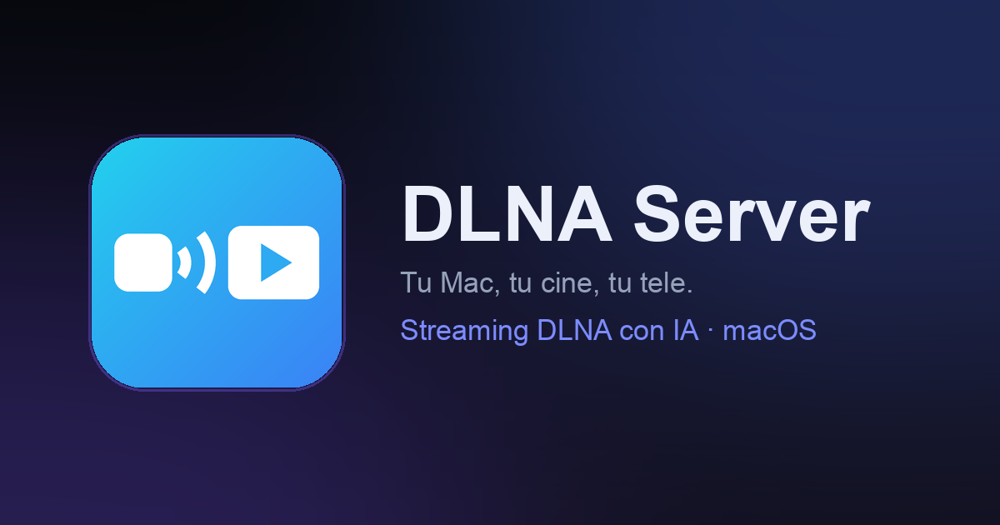
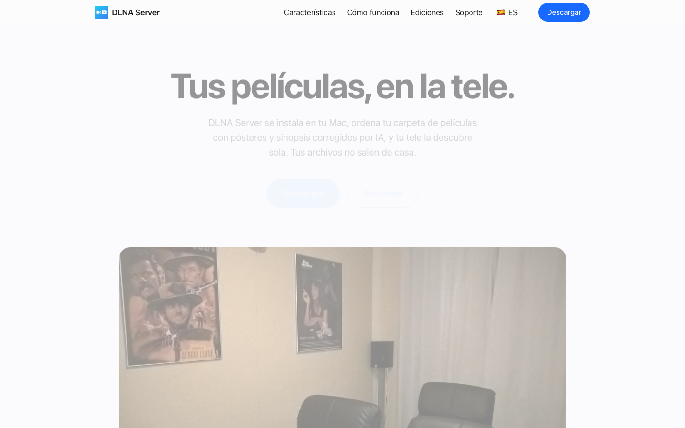

  

<h1 align="center">DLNA Server for macOS</h1>

Transformez votre Mac en serveur multimédia DLNA/UPnP complet. Diffusez votre bibliothèque de films vers n'importe quel téléviseur, console ou lecteur du réseau — avec métadonnées IA, affiches et TV en direct.

  
  
  
  

🌍 <a href="README.es.md">🇪🇸 Español</a> · <a href="README.md">🇬🇧 English</a> · <a href="README.de.md">🇩🇪 Deutsch</a> · <strong>🇫🇷 Français</strong> · <a href="README.it.md">🇮🇹 Italiano</a> · <a href="README.pt.md">🇵🇹 Português</a>

> **Ce dépôt publie uniquement les releases officielles** — le code source est privé. Téléchargements signés, sommes de contrôle et flux de mise à jour automatique.

## Téléchargement

| | |
|---|---|
| 📥 **Version complète** | [Télécharger le dernier DMG](https://github.com/mavksoft/dlnaserver-releases/releases/latest) — essai gratuit, licence à vie 19,90 € |
| 🌍 **Site officiel** | [www.dlnaserver.com](https://www.dlnaserver.com) — guides, assistance et achat |
| 📱 **Lite** | Une édition Lite en sandbox est en route vers le Mac App Store |

## Qu'est-ce que c'est

DLNA Server transforme le dossier de films de votre Mac en un vrai serveur multimédia : films et séries apparaissent sur le téléviseur avec affiche, synopsis et sous-titres — rien à installer sur la TV. Tout fonctionne en local ; votre bibliothèque ne quitte jamais le Mac.

## Fonctionnalités

- **Serveur DLNA/UPnP** — découverte SSDP, navigation ContentDirectory, streaming HTTP par plages. Compatible avec les TV Samsung/LG/Sony, VLC, Kodi, consoles…
- **Bibliothèque assistée par IA** — nettoyage automatique des noms de fichiers, identification des films, affiches, notes, bandes-annonces et métadonnées dans votre langue (ES/EN/FR/IT/DE/PT + langues gérées à distance).
- **TV en direct & IPTV** — listes M3U et portails Xtream/Stalker, EPG, logos de chaînes et enregistrement — totalement indépendant de la bibliothèque DLNA.
- **Téléchargements intégrés** — moteur torrent (TorrServer) et client eD2k/eMule natif.
- **Sous-titres et jaquettes** — `.srt` externes, pistes intégrées et endpoints d'artwork DLNA pour chaque lecteur.
- **App de barre de menus** — vit dans la barre ; continue de diffuser fenêtre fermée.
- **Lecteur web local** — regardez depuis n'importe quel navigateur, avec reprise de lecture.
- **Confidentialité d'abord** — votre bibliothèque ne quitte jamais le Mac ; seules des statistiques anonymes optionnelles.

## Mode d'emploi

1. Téléchargez le DMG, glissez DLNA Server dans Applications et ouvrez-le.
2. Choisissez les dossiers contenant vos films, séries et musique.
3. L'icône apparaît dans la barre de menus — le serveur est déjà visible sur le réseau.
4. Sur la TV (ou VLC/Kodi/console), cherchez « DLNA Server » dans les sources et parcourez votre bibliothèque.
5. Optionnel : ajoutez une liste M3U dans les Réglages pour la TV en direct avec guide EPG.

## Éditions et tarifs

|  | Lite | Pro |
|---|---|---|
| **Prix** | Gratuit | 19,90 € · achat unique |
| **Serveur DLNA** | ✓ | ✓ |
| **Bibliothèque IA** | Limitée | Complète |
| **IPTV + EPG + enregistrement** | — | ✓ |
| **Distribution** | Mac App Store (bientôt) | DMG sur cette page |

## Configuration requise

macOS 13 (Ventura) ou ultérieur · Apple Silicon et Intel (binaire universel) · Signé et notarisé par Apple.

## Contenu de ce dépôt

- `DLNA-Server-<version>.dmg` — installateur signé + notarisé, à glisser dans Applications
- `DLNA-Server-<version>.zip` — archive de mise à jour (signée EdDSA) utilisée par le mécanisme d'auto-mise à jour

[Dernière version](https://github.com/mavksoft/dlnaserver-releases/releases/latest)

## Questions fréquentes

**Est-ce compatible avec mon téléviseur ?**  
Si votre TV prend en charge DLNA/UPnP (Samsung, LG, Sony — la plupart depuis 2010) ou si vous utilisez VLC/Kodi/Fire TV, oui. Rien à installer sur la TV.

**Mes films sont-ils envoyés dans un cloud ?**  
Non. Tout le traitement et le streaming se font sur votre réseau local. L'IA interroge des bases de métadonnées publiques, mais vos fichiers ne quittent jamais le Mac.

**La licence est-elle un abonnement ?**  
Non. Pro est un achat unique de 19,90 € avec mises à jour incluses.

## Assistance

- Site : [www.dlnaserver.com](https://www.dlnaserver.com) · Assistance : [/soporte](https://www.dlnaserver.com/soporte)
- E-mail : [support@it-systems.es](mailto:support@it-systems.es)

---

DLNA Server for macOS · © MavkSoft / IT-Systems

